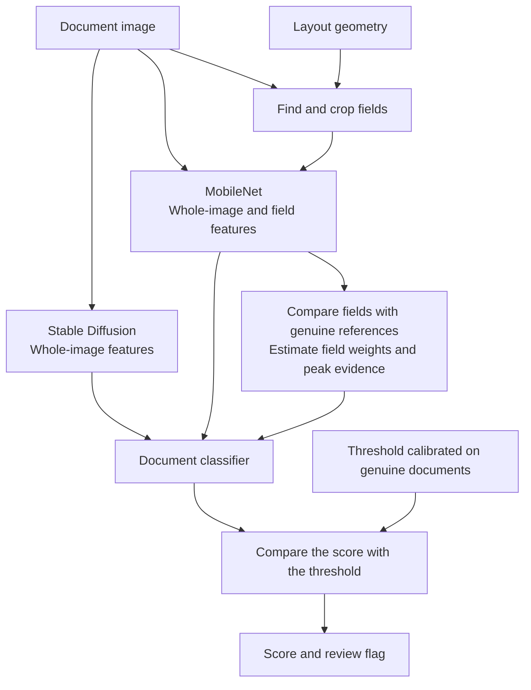
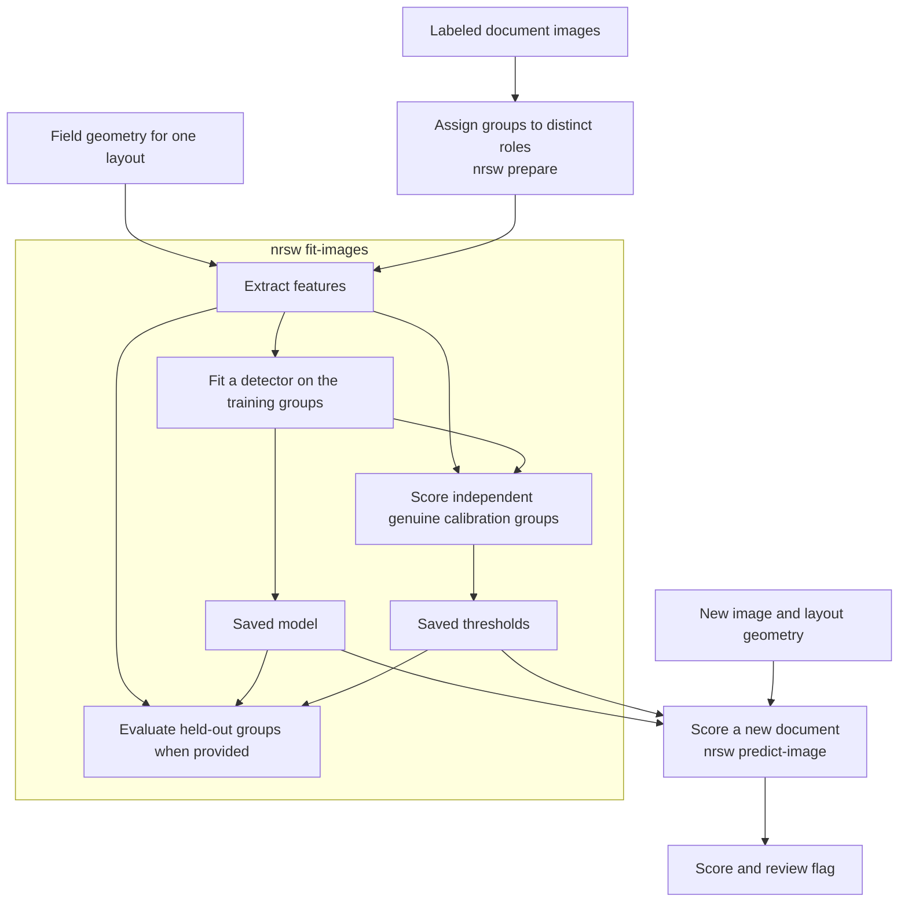
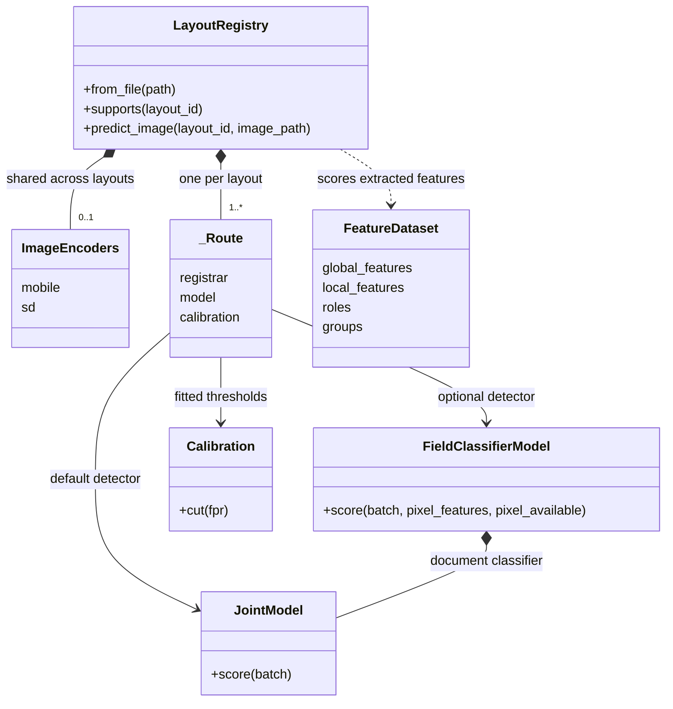

# Architecture

NRSW scores documents from a known layout. The same Stable Diffusion and MobileNet encoders can serve several layouts. Each layout has its own field positions, fitted detector, and thresholds. The caller supplies the layout ID when requesting a prediction.

## How an image is scored

The detector measures how unusual each field looks relative to the corresponding field in genuine documents. The document classifier uses the individual field features, their weighted summary, the peak evidence, and whole-image features. Whole-image features remain available when fields cannot be located. Above the threshold, the detector flags the document for review.

## From training images to predictions

Tag one or two candidate fields on each training forgery. To score a new image, pass its layout and use the saved model and thresholds. See the [training guide](training.md) to fit your own layout and the [layout registry guide](layouts.md) to serve several layouts in one process.

## Main classes

The optional field-classifier model contains a refitted document branch and separate field branches. Genuine training rows define their score scales; independent genuine calibration rows define the threshold of the combined maximum score. See [field-classifier details](field-classifiers.md).

The public Python API accepts a `FeatureDataset` in `fit`, `calibrate`, and `predict`. `LayoutRegistry` adds image extraction and layout selection for applications that call NRSW directly. A registry loads its encoders when first needed and shares them across its layout entries.
